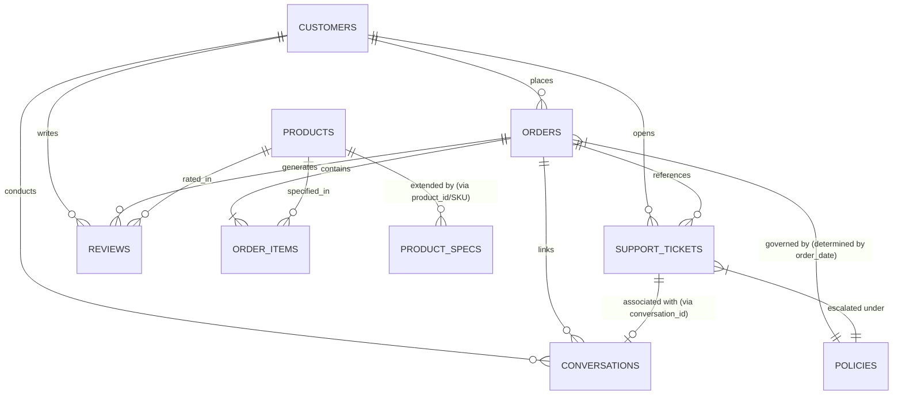

# Resource Inventory - NovaMart AI Customer Support Agent

## Overview

This inventory documents all 31 official resources and project assets for the NovaMart AI Customer Support Agent system, thoroughly verified against the codebase and data files in `data/`, `policies/`, and `product_specs/`.

---

## 1. Project Files Discovered in Workspace

| File / Directory Path | Description / Purpose | Status |
|---|---|---|
| [`README.md`](file:///c:/Users/Urvi%20Sawant/OneDrive/Desktop/ai-customer-support/README.md) | High-level project goals, features, and technology stack outline. | Present |
| [`requirements.txt`](file:///c:/Users/Urvi%20Sawant/OneDrive/Desktop/ai-customer-support/requirements.txt) | Python dependencies (`fastapi`, `uvicorn`, `pydantic`, etc.). | Present |
| [`backend/main.py`](file:///c:/Users/Urvi%20Sawant/OneDrive/Desktop/ai-customer-support/backend/main.py) | Entry point for FastAPI backend with basic health check endpoints. | Present |
| `.gitignore` | Git repository ignore configuration. | Present |
| [`docs/resource_inventory.md`](file:///c:/Users/Urvi%20Sawant/OneDrive/Desktop/ai-customer-support/docs/resource_inventory.md) | Master resource inventory and source-of-truth specification. | Present |

---

## 2. Official Project Resources (31 Total Resources)

### A. Structured Data (7 Datasets in `data/`)

Authoritative for transactional, customer, order, product status, and support history fields.

| File Path | Format | Records | Key Schema / Fields | Purpose |
|---|---|---|---|---|
| [`data/customers.csv`](file:///c:/Users/Urvi%20Sawant/OneDrive/Desktop/ai-customer-support/data/customers.csv) | CSV | 1,501 | `customer_id`, `first_name`, `last_name`, `email`, `phone`, `gender`, `date_of_birth`, `city`, `state`, `pincode`, `address`, `customer_since`, `customer_segment`, `account_status`, `preferred_language`, `total_orders`, `total_spend`, `loyalty_tier` | Master store of customer profiles, contact info, loyalty tier, and account statuses. |
| [`data/orders.csv`](file:///c:/Users/Urvi%20Sawant/OneDrive/Desktop/ai-customer-support/data/orders.csv) | CSV | 8,001 | `order_id`, `customer_id`, `order_date`, `order_status`, `payment_method`, `payment_status`, `subtotal`, `discount`, `shipping_fee`, `tax`, `total_amount`, `shipping_address`, `city`, `state`, `estimated_delivery_date`, `actual_delivery_date`, `tracking_number`, `courier`, `delivery_status`, `delivery_otp_verified`, `cancellation_status`, `refund_status` | Master order headers tracking financial totals, delivery tracking, OTP verification, cancellation, and refund statuses. |
| [`data/order_items.csv`](file:///c:/Users/Urvi%20Sawant/OneDrive/Desktop/ai-customer-support/data/order_items.csv) | CSV | 12,445 | `order_item_id`, `order_id`, `product_id`, `quantity`, `unit_price`, `discount`, `final_price`, `item_status`, `return_status`, `refund_amount` | Granular line items linking orders to products with item-level pricing, return statuses, and item refunds. |
| [`data/products.csv`](file:///c:/Users/Urvi%20Sawant/OneDrive/Desktop/ai-customer-support/data/products.csv) | CSV | 301 | `product_id`, `sku`, `product_name`, `category`, `subcategory`, `brand`, `description`, `price`, `mrp`, `discount_percent`, `stock_quantity`, `warranty_months`, `returnable`, `replacement_available`, `rating`, `review_count`, `weight_kg`, `color`, `status` | Authoritative catalog of product metadata, pricing, inventory stock, returnability, replacement flags, and warranty duration. |
| [`data/reviews.csv`](file:///c:/Users/Urvi%20Sawant/OneDrive/Desktop/ai-customer-support/data/reviews.csv) | CSV | 3,001 | `review_id`, `product_id`, `customer_id`, `order_id`, `rating`, `title`, `review_text`, `review_date`, `verified_purchase`, `helpful_votes` | Customer ratings, reviews, and feedback records per product and order. |
| [`data/support_tickets.csv`](file:///c:/Users/Urvi%20Sawant/OneDrive/Desktop/ai-customer-support/data/support_tickets.csv) | CSV | 2,501 | `ticket_id`, `customer_id`, `order_id`, `created_at`, `category`, `subcategory`, `priority`, `status`, `assigned_team`, `issue_summary`, `resolution`, `created_by`, `resolved_at`, `conversation_id` | Log of historical support tickets, issue categories, resolution statuses, and agent assignments. |
| [`data/conversations.json`](file:///c:/Users/Urvi%20Sawant/OneDrive/Desktop/ai-customer-support/data/conversations.json) | JSON | ~63.5k lines | `conversation_id`, `customer_id`, `order_id`, `ticket_id`, `channel`, `language`, `started_at`, `status`, `handled_by`, `messages` (`role`, `timestamp`, `message`) | Transcripts of historical chat interactions between customers and agents/bots. |

---

### B. Policy Documents (10 Documents in `policies/`)

Authoritative for business rules, policy windows, refund amounts, shipping fees, and escalation protocols.

| File Path | Policy Name | Version | Effective Date | Major Purpose & Business Rules |
|---|---|---|---|---|
| [`policies/cancellation_policy.md`](file:///c:/Users/Urvi%20Sawant/OneDrive/Desktop/ai-customer-support/policies/cancellation_policy.md) | NovaMart Cancellation Policy | 1.0 | **2026-01-01** | Order cancellation rules by status (`placed`/`confirmed`/`processing` allowed; `shipped`/`out_for_delivery` rejected). Governs full refunds (including shipping fee), auto-cancellations (failed payments), duplicate order rules, and 5-cancellation abuse threshold. |
| [`policies/customer_escalation_policy.md`](file:///c:/Users/Urvi%20Sawant/OneDrive/Desktop/ai-customer-support/policies/customer_escalation_policy.md) | Customer Escalation & Support Conduct Policy | 1.0 | **2026-01-01** | Security & trust boundaries (untrusted prompt injection defence), 4-outcome decision framework (Answer, Ask Clarification, Take Action, Escalate), mandatory human escalation triggers, fraud risk signals, SLAs, and Tier 1 agent authority limits. |
| [`policies/payment_policy.md`](file:///c:/Users/Urvi%20Sawant/OneDrive/Desktop/ai-customer-support/policies/payment_policy.md) | NovaMart Payment & Refund Destination Policy | 1.0 | **2026-01-01** | Payment methods (COD max INR 50,000, 18% GST calculation), payment states (`pending`, `paid`, `failed`, `refunded`), unconfirmed payment rules (24h wait), strict original payment instrument refund destination, and refund timelines (instant to 7 days). |
| [`policies/refund_policy_v1.md`](file:///c:/Users/Urvi%20Sawant/OneDrive/Desktop/ai-customer-support/policies/refund_policy_v1.md) | NovaMart Refund Policy | **v1** | **2026-01-01** (Orders placed 2026-01-01 to 2026-05-31) | 10-day change of mind window, 15-day defect/damage/wrong item window. Item refund = `final_price` + 18% GST. Agent approval threshold: order total **<= INR 1,00,000**. Zero restocking fee. Loyalty extensions (Gold +2d, Platinum +3d). |
| [`policies/refund_policy_v2.md`](file:///c:/Users/Urvi%20Sawant/OneDrive/Desktop/ai-customer-support/policies/refund_policy_v2.md) | NovaMart Refund Policy | **v2** | **2026-06-01** (Orders placed on or after 2026-06-01) | 7-day change of mind window, 10-day defect/damage/wrong item window. Introduces **5% restocking fee (max INR 2,500)** on change-of-mind for Laptops, Tablets, Cameras, Monitors. Lowers agent approval threshold to order total **<= INR 75,000**. |
| [`policies/replacement_policy.md`](file:///c:/Users/Urvi%20Sawant/OneDrive/Desktop/ai-customer-support/policies/replacement_policy.md) | NovaMart Replacement Policy | 1.0 | **2026-01-01** | Rules for product replacements when `replacement_available = true` within defect windows (v1: 15d, v2: 10d) with mandatory evidence. Free shipping on exchange; resets warranty period upon replacement delivery. |
| [`policies/return_policy_v1.md`](file:///c:/Users/Urvi%20Sawant/OneDrive/Desktop/ai-customer-support/policies/return_policy_v1.md) | NovaMart Return Policy | **v1** | **2026-01-01** (Orders placed 2026-01-01 to 2026-05-31) | Return eligibility conditions, returnable vs non-returnable items (earbuds, opened accessories non-returnable for change of mind unless defective), 4-step pickup & warehouse QC process, zero restocking fee. |
| [`policies/return_policy_v2.md`](file:///c:/Users/Urvi%20Sawant/OneDrive/Desktop/ai-customer-support/policies/return_policy_v2.md) | NovaMart Return Policy | **v2** | **2026-06-01** (Orders placed on or after 2026-06-01) | Updated return scope (7-day change of mind, 10-day defect window), 5% restocking fee (max INR 2,500) for Laptops, Tablets, Cameras, Monitors on change of mind, lowered approval threshold (INR 75,000 order total), summary of differences from v1. |
| [`policies/shipping_policy.md`](file:///c:/Users/Urvi%20Sawant/OneDrive/Desktop/ai-customer-support/policies/shipping_policy.md) | NovaMart Shipping & Delivery Policy | 1.0 | **2026-01-01** | Delivery estimates, shipping fee rules (free on orders >= INR 1,000; flat INR 79 below), OTP delivery verification for orders >= INR 5,000, delay management & goodwill wallet credits (INR 100 per 3 days late, max INR 300), "Delivered but not received" procedures. |
| [`policies/warranty_policy.md`](file:///c:/Users/Urvi%20Sawant/OneDrive/Desktop/ai-customer-support/policies/warranty_policy.md) | NovaMart Warranty Policy | 1.0 | **2026-01-01** | Manufacturer warranty coverage (`warranty_months`, 6-36 months), warranty vs return/refund distinction (inside return window = refund/replacement; after return window but within warranty = repair/replacement, no refund; after warranty = paid repair), safety incident protocols (swollen battery, smoke). |

---

### C. Product Specification Knowledge (14 Files in `product_specs/`)

Category-specific Markdown specification sheets carrying detailed technical attributes, hardware/software specs, package contents, and physical dimensions for NovaMart products.

| File Path | Category Name | Key Technical Attributes Covered |
|---|---|---|
| [`product_specs/accessories.md`](file:///c:/Users/Urvi%20Sawant/OneDrive/Desktop/ai-customer-support/product_specs/accessories.md) | **Accessories** | Chargers, webcams, memory cards, power banks, cables, laptop bags, hubs, screen protectors. Tech specs: Output wattage, compatibility, materials, length, transfer speeds. |
| [`product_specs/cameras.md`](file:///c:/Users/Urvi%20Sawant/OneDrive/Desktop/ai-customer-support/product_specs/cameras.md) | **Cameras** | Vlogging cameras, action cameras, security cameras, mirrorless, instant cameras. Tech specs: Sensor size/resolution, video recording fps, battery capacity, lens focal length, connectivity. |
| [`product_specs/earbuds.md`](file:///c:/Users/Urvi%20Sawant/OneDrive/Desktop/ai-customer-support/product_specs/earbuds.md) | **Earbuds** | Sports earbuds, TWS earbuds, noise-cancelling earbuds. Tech specs: Driver size, battery playtime, active noise cancellation type, IP rating, Bluetooth version. |
| [`product_specs/gaming.md`](file:///c:/Users/Urvi%20Sawant/OneDrive/Desktop/ai-customer-support/product_specs/gaming.md) | **Gaming** | Mousepads, controllers, gaming chairs, headsets, gaming keyboards. Tech specs: Supported platforms, polling rate, lighting RGB, sensor DPI, ergonomics. |
| [`product_specs/headphones.md`](file:///c:/Users/Urvi%20Sawant/OneDrive/Desktop/ai-customer-support/product_specs/headphones.md) | **Headphones** | Over-ear ANC headphones, on-ear wireless, studio headphones. Tech specs: Driver diameter, battery life, ANC mode, frequency response, impedance. |
| [`product_specs/keyboards.md`](file:///c:/Users/Urvi%20Sawant/OneDrive/Desktop/ai-customer-support/product_specs/keyboards.md) | **Keyboards** | Gaming mechanical keyboards, slim wireless keyboards, ergonomic keyboards. Tech specs: Layout size (60%/75%/100%), switch types (tactile/linear), connectivity, backlighting. |
| [`product_specs/laptops.md`](file:///c:/Users/Urvi%20Sawant/OneDrive/Desktop/ai-customer-support/product_specs/laptops.md) | **Laptops** | Creator laptops, gaming laptops, ultrabooks, business laptops. Tech specs: RAM size, SSD storage, processor cores/clock speed, display resolution/refresh rate, GPU model. |
| [`product_specs/mice.md`](file:///c:/Users/Urvi%20Sawant/OneDrive/Desktop/ai-customer-support/product_specs/mice.md) | **Mice** | Gaming mice, ergonomic wireless mice, trackball mice. Tech specs: Optical sensor DPI, button count, connectivity, battery type, weight. |
| [`product_specs/monitors.md`](file:///c:/Users/Urvi%20Sawant/OneDrive/Desktop/ai-customer-support/product_specs/monitors.md) | **Monitors** | 4K monitors, gaming monitors, curved monitors, ultrawide displays. Tech specs: Screen size, resolution, refresh rate, panel technology (IPS/OLED/VA), HDR support, port selection. |
| [`product_specs/networking.md`](file:///c:/Users/Urvi%20Sawant/OneDrive/Desktop/ai-customer-support/product_specs/networking.md) | **Networking** | WiFi routers, mesh WiFi systems, powerline kits, network switches. Tech specs: WiFi standard (WiFi 5/6), LAN ports, coverage area, wireless bandwidth. |
| [`product_specs/smartphones.md`](file:///c:/Users/Urvi%20Sawant/OneDrive/Desktop/ai-customer-support/product_specs/smartphones.md) | **Smartphones** | Foldable phones, flagship smartphones, budget 5G smartphones. Tech specs: RAM, internal storage, display technology/refresh rate, camera Megapixels, battery capacity, 5G band support. |
| [`product_specs/smartwatches.md`](file:///c:/Users/Urvi%20Sawant/OneDrive/Desktop/ai-customer-support/product_specs/smartwatches.md) | **Smartwatches** | Fitness bands, outdoor rugged smartwatches, classic smartwatches. Tech specs: Display type, battery duration, health sensors (Heart rate/SpO2), water resistance depth, GPS. |
| [`product_specs/speakers.md`](file:///c:/Users/Urvi%20Sawant/OneDrive/Desktop/ai-customer-support/product_specs/speakers.md) | **Speakers** | Desktop speakers, portable Bluetooth speakers, soundbars, party speakers. Tech specs: RMS output wattage, battery capacity, Bluetooth version, water resistance rating, audio inputs. |
| [`product_specs/tablets.md`](file:///c:/Users/Urvi%20Sawant/OneDrive/Desktop/ai-customer-support/product_specs/tablets.md) | **Tablets** | Pro tablets, educational tablets, compact tablets. Tech specs: RAM, storage, screen size/resolution, processor model, battery capacity, stylus compatibility, cellular support. |

---

## 3. Source-of-Truth Rules

1. **Authoritative Structured Database (`data/*.csv`, `data/*.json`)**:
   - `data/products.csv` is authoritative for structured product attributes including `price`, `mrp`, `discount_percent`, `stock_quantity`, `returnable`, `replacement_available`, `warranty_months`, SKU, `rating`, and `status`.
   - `data/orders.csv` and `data/order_items.csv` are authoritative for order status, transaction amounts, payment status, delivery dates, delivery OTP verification, cancellation status, and item-level refund amounts.
   - `data/customers.csv`, `data/support_tickets.csv`, and `data/conversations.json` are authoritative for customer accounts, loyalty tiers, past tickets, and conversation histories.

2. **Product Specification Knowledge (`product_specs/*.md`)**:
   - The 14 Markdown files contain supplementary technical specifications, physical attributes, hardware details, and package contents.
   - They are **NOT** duplicates of `data/products.csv` and must **NOT** replace `data/products.csv`.
   - Product specifications map to products via `product_id` and/or `SKU`.
   - Do **NOT** invent technical specifications not listed in the inspected Markdown files.
   - Product specification files must **NOT** be treated as policy documents.

3. **Authoritative Policy Documents (`policies/*.md`)**:
   - Policy files are authoritative for support policies, refund math, return windows, cancellation rules, shipping fees, replacement conditions, warranty coverage, and human escalation triggers.
   - **Version Mapping Rule**: The applicable policy version (v1 vs v2) is strictly determined by the **order placement date (`orders.order_date`)**:
     - Orders placed between **2026-01-01 00:00 IST and 2026-05-31 23:59 IST** are governed by **v1 policies** (10-day change of mind, 15-day defect window, INR 1,00,000 AI approval threshold, zero restocking fee).
     - Orders placed on or after **2026-06-01 00:00 IST** are governed by **v2 policies** (7-day change of mind, 10-day defect window, INR 75,000 AI approval threshold, 5% restocking fee up to INR 2,500 on Laptops, Tablets, Cameras, Monitors for change of mind).
   - Newer versions are **NEVER applied retroactively**.

4. **Conflict Resolution & Strict Domain Rules**:
   - In case of any conflict or ambiguity, structured data overrides text descriptions, and policy documents override agent assumptions.
   - Do **NOT** invent tool parameters, database fields, policy rules, fees, or business thresholds.

---

## 4. Verified Entity Relationship Diagram

---

## 5. Summary of Verified Resources

All 31 official project resources are verified present in the workspace directory with zero missing files:
- **7 Structured Datasets**: `data/customers.csv`, `data/orders.csv`, `data/order_items.csv`, `data/products.csv`, `data/reviews.csv`, `data/support_tickets.csv`, `data/conversations.json`.
- **10 Policy Documents**: `policies/cancellation_policy.md`, `policies/customer_escalation_policy.md`, `policies/payment_policy.md`, `policies/refund_policy_v1.md`, `policies/refund_policy_v2.md`, `policies/replacement_policy.md`, `policies/return_policy_v1.md`, `policies/return_policy_v2.md`, `policies/shipping_policy.md`, `policies/warranty_policy.md`.
- **14 Product Specification Documents**: `product_specs/accessories.md`, `cameras.md`, `earbuds.md`, `gaming.md`, `headphones.md`, `keyboards.md`, `laptops.md`, `mice.md`, `monitors.md`, `networking.md`, `smartphones.md`, `smartwatches.md`, `speakers.md`, `tablets.md`.
